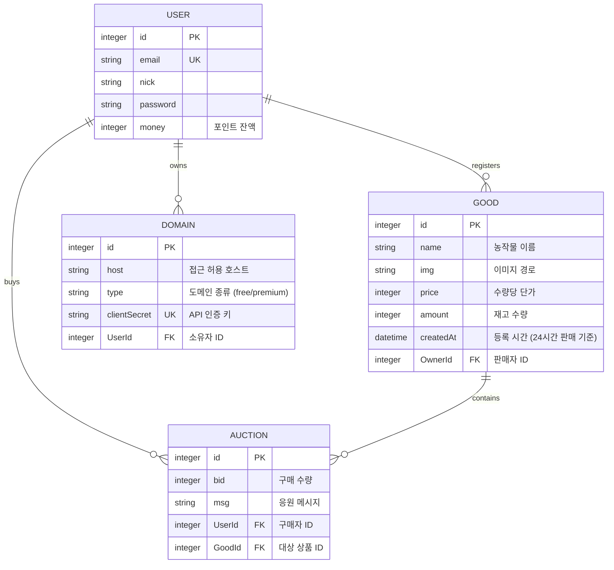
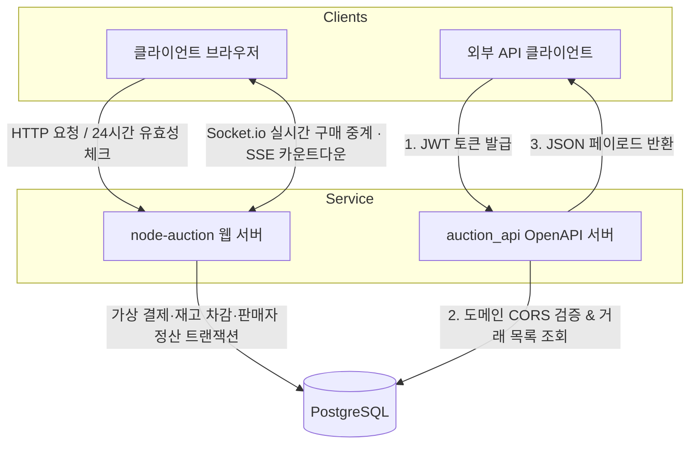

# 🥒 Jukini-Market (쭈끼니 마켓)

> **🌐 Live Demo:** 준비 중 — 게이트웨이([demo-gateway.trealight112.workers.dev](https://demo-gateway.trealight112.workers.dev/))에서 곧 공개됩니다.  
> **체험 계정:** `demo@jukini.demo` / `jukini1234` (100만 포인트 지급)  
> **Project Date:** 2021.12.01 ~ 2021.12.15  
> **Collaborator:** @malangcongdduck  
> **Revived & Refactored for Live Demo:** 2026.08.20

당근마켓에서 영감을 받아 **농작물을 기른다면 누구나 쉽게 판매할 수 있는 직거래 마켓**을 구현했습니다. **신선함 유지**를 위해 **판매 등록 후 24시간 동안만 구매**할 수 있고, 홈쇼핑처럼 **구매가 일어나는 순간을 모두에게 실시간 중계**하여 판매를 촉진하는 셀프 마케팅 기능을 갖추고 있습니다.

---

## 📖 프로젝트 개요

* **당근마켓에서 영감을 얻은 농작물 직거래 마켓** — 생산자는 남은 농작물을 저렴하게 판매하고, 소비자는 신선한 농작물을 합리적인 가격에 직거래로 구매.
* **24시간 신선도 제한** — 등록 후 24시간이 지난 상품은 자동으로 거래가 제한되어 신선도와 신뢰성 확보.
* **실시간 구매 중계 (셀프 마케팅)** — 구매 발생 시 Socket.io로 같은 상품을 보는 모든 유저에게 즉시 중계, SSE 서버 시계 기반 판매 종료 카운트다운 제공.
* **가상 포인트 결제** — 가입 시 지급되는 포인트로 구매하고, 거래 대금은 판매자에게 자동 정산되는 포인트 순환 구조.

---

## ♻️ 2026 리뉴얼 (라이브 데모 개편)

2021년 원본을 라이브 데모로 되살리며 다음을 복원·수정·개선했습니다.

| 분류 | 내용 |
|---|---|
| **복원** | 유실되어 있던 화면 템플릿 6종(main/join/good/list/lookup/error) 재구축 + 반응형 CSS 신규 작성 |
| **복원** | 주석으로만 남아있던 판매 종료 후속 처리 잡(`checkAuction.js`) 구현 — node-schedule 기반 |
| **보안** | 회원가입 시 `money` 값을 클라이언트가 주입할 수 있던 매스어사인먼트 결함 제거 (서버가 지급액 결정) |
| **보안** | 구매 시 잔액 검증 추가 (기존엔 잔액이 음수가 될 수 있었음) + 업로드 파일 이미지 타입 검증 (stored XSS 차단) |
| **버그** | Referer 없는 소켓 접속 시 서버가 죽던 문제, SSE 타이머 누수, 구매 수량 미검증(NaN) 수정 |
| **개선** | 판매자 대금 자동 정산(포인트 순환 완성), 로그인 필요 페이지 UX, 판매 목록에 판매량/매출/상태 표시 |
| **현대화** | MySQL→**PostgreSQL**(대소문자 식별자 버그 수정 포함), socket.io 2→4, bcrypt→bcryptjs, Node 20+ 대응 |
| **데모 인프라** | 시드 데이터(판매자/체험 계정/상품 4종), 만료된 데모 상품 자동 재등록(매시 정각), rate limit |

---

## 📂 디렉터리 구조 (Directory Structure)

실시간 거래 웹앱(`node-auction`)과 외부 데이터 제공용 서버(`auction_api`), API 연동 데모 앱(`auctioncat`)이 독립적으로 관리되며, 라우터에서 비즈니스 로직을 분리(MVC)한 구조입니다.

```text
Jukini-Market/
├── node-auction/             # 메인 웹앱: 직거래 마켓 (라이브 데모 배포 대상)
│   ├── app.js                # Express 설정, Nunjucks, rate limit, 시드/스케줄 잡 부트스트랩
│   ├── controllers/          # 비즈니스 로직 (index.js: 상품/구매 트랜잭션, auth.js: 인증)
│   ├── routes/               # 라우팅 + 미들웨어 + 업로드(multer, 이미지 검증)
│   ├── models/               # Sequelize 모델 (User, Good, Auction)
│   ├── views/                # Nunjucks 템플릿 7종
│   ├── public/main.css       # 반응형 스타일시트
│   ├── socket.js             # Socket.io: 상품별 룸 실시간 구매 중계
│   ├── sse.js                # SSE: 서버 시계 브로드캐스트 (카운트다운용)
│   ├── seed.js               # 데모 시드 데이터 (계정/상품)
│   └── checkAuction.js       # 판매 종료 후속 처리 + 데모 상품 자동 재등록 잡
├── auction_api/              # 외부 전송용 OpenAPI 서버 (JWT + 도메인 기반 CORS)
└── auctioncat/               # API 클라이언트 연동 데모 앱
```

---

## 📊 데이터 아키텍처

사용자(User), 상품(Good), 구매(Auction), 외부 연동 도메인(Domain) 테이블이 1:N 관계로 Sequelize ORM을 통해 관리됩니다. (DB: **PostgreSQL**)





---

## 🎯 사용한 기술

* **Backend** — Node.js 20+, Express 4, Sequelize 6 (PostgreSQL), Passport + bcryptjs 인증
* **Realtime** — Socket.io 4 (상품별 룸 구매 중계), SSE (서버 시계 카운트다운)
* **Frontend** — Nunjucks 템플릿, 반응형 CSS
* **Infra/기타** — node-schedule (판매 종료 처리 잡), express-rate-limit, multer (이미지 업로드), Artillery (부하 테스트)

---

## 💥 트러블 슈팅 (Trouble Shooting)

### 동시 구매 시 발생할 수 있는 데이터 정합성 이슈
* **현상:** 여러 사용자가 동시에 하나의 상품에 구매 요청을 보낼 때, 한정 수량이 초과 판매되거나 포인트가 음수가 되는 부정합 가능성.
* **원인:** 구매 기록 생성, 재고 차감, 포인트 정산이 트랜잭션 없이 독립 실행되어 동시성 경쟁 발생.
* **해결:** Sequelize `transaction`으로 다섯 개 연산(구매 기록·재고 차감·잔액 검증·구매자 차감·판매자 입금)을 하나의 작업 단위로 묶고, 상품/구매자 조회에 `lock: t.LOCK.UPDATE`를 적용해 동시 요청에서도 무결성 보장. 실시간 소켓 중계는 커밋 이후에만 발송.

### MySQL→PostgreSQL 이전 시 식별자 대소문자 문제
* **현상:** MySQL에서 동작하던 쿼리가 Postgres에서 `column does not exist` 오류 발생.
* **원인:** Sequelize가 생성하는 FK 컬럼명은 `GoodId`/`UserId`(대문자)인데 일부 쿼리가 `goodId`/`userId`로 참조 — MySQL은 컬럼명 대소문자를 구분하지 않아 우연히 동작했던 것.
* **해결:** 모델이 정의한 정확한 컬럼명으로 통일. 방언(dialect)의 관용에 기대지 않고 ORM 스키마를 기준으로 삼도록 정리.

---

## 🛠️ 실행 및 사용 방법

### 로컬 실행 (node-auction)

```bash
cd node-auction
npm install
cp .env.example .env   # 값 채우기 (로컬 테스트는 DB_DIALECT=sqlite 로 DB 없이 실행 가능)
npm run dev            # 개발 모드 (nodemon) — 기본 8010 포트
```

서버가 뜨면 시드 데이터(체험 계정, 데모 상품 4종)가 자동 생성됩니다.

### 배포 (Render + Neon)

* **DB:** Neon 무료 PostgreSQL — `DATABASE_URL` 환경변수 하나로 연결 (SSL 자동 적용)
* **서버:** Render 무료 Web Service — Build `npm install`, Start `npm start`, 환경변수 `DATABASE_URL`/`COOKIE_SECRET`/`NODE_ENV=production` 설정

### auction_api / auctioncat (선택)

외부 OpenAPI 제공·소비 데모입니다. 각 디렉터리에서 `npm install` 후 `npm start` (기본 8012 / 4000 포트).
