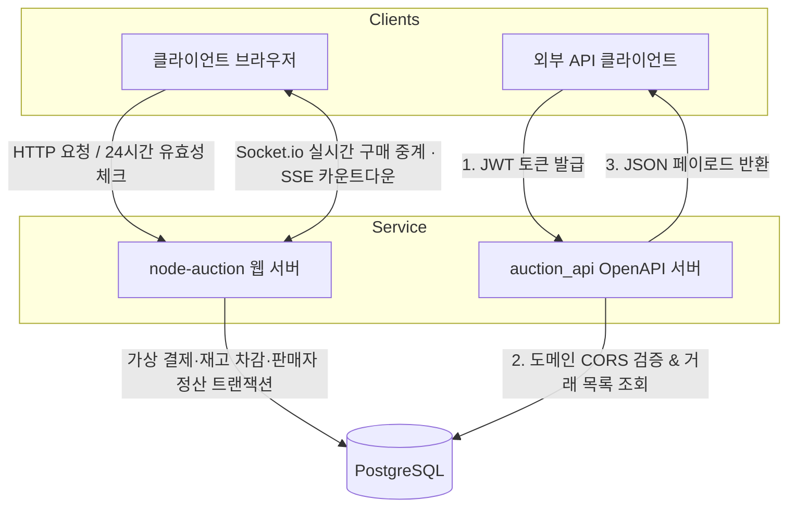
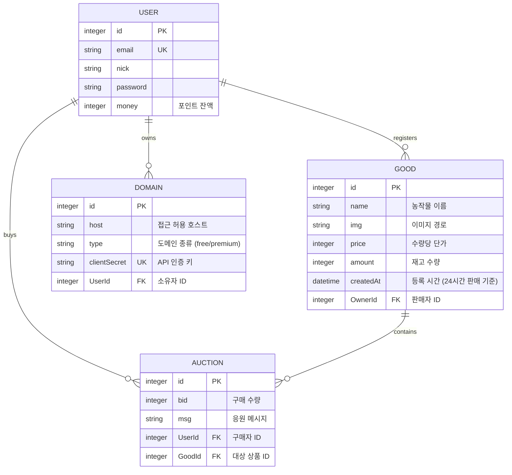

# 🥒 쭈끼니 마켓 (Jukini-Market)

> **등록 후 24시간 동안만 파는 농작물 직거래 마켓.**
>
> **Project Date:** 2021.12.01 ~ 2021.12.15 · **2인 팀 프로젝트** (2026.08 라이브 데모로 리뉴얼)
>
> **Platform:** 웹 (Node.js + Express + Nunjucks) · Socket.io 실시간 중계 · PostgreSQL
>
> **Role:** 백엔드 API · DB 모델링 · 부하 테스트·서버 안정화
>
> **Live Demo:** [jukini-market.onrender.com](https://jukini-market.onrender.com) — 무료 서버라 첫 접속 시 깨어나는 데 최대 1분 걸릴 수 있습니다.

당근마켓에서 영감을 받아 **농작물을 기른다면 누구나 쉽게 판매할 수 있는 직거래 마켓**을 구현했습니다. 신선함을 지키기 위해 **판매 등록 후 24시간 동안만 구매**할 수 있고, 홈쇼핑처럼 **구매가 일어나는 순간을 같은 상품을 보는 모두에게 실시간 중계**해 판매를 촉진합니다.

구매 한 건은 구매 기록·재고 차감·포인트 정산이 함께 움직이는 작업이라, **하나의 트랜잭션과 행 잠금**으로 묶고 **커밋이 끝난 뒤에만 중계**하도록 만들었습니다.

---

## 📖 프로젝트 개요

생산자는 남은 농작물을 저렴하게 판매하고, 소비자는 신선한 농작물을 합리적인 가격에 직거래로 구매하는 마켓입니다.
쭈끼니 마켓은 신선도와 판매 촉진을 **24시간 판매 제한 + 실시간 구매 중계 + 가상 포인트 결제**로 풉니다.

* **24시간 신선도 제한** — 등록 후 24시간이 지난 상품은 거래가 제한되어 신선도와 신뢰성 확보
* **실시간 구매 중계 (셀프 마케팅)** — 구매가 발생하면 같은 상품을 보는 모든 사용자에게 즉시 중계
* **가상 포인트 결제** — 가입 시 지급되는 포인트로 구매하고, 거래 대금은 판매자에게 자동 정산되는 포인트 순환 구조

### 💡 주요 기능

| 기능 | 설명 |
|---|---|
| ⏰ **24시간 한정 판매** | 메인에는 최근 24시간 안에 등록된 상품만 노출하고, 구매 요청 때 서버가 판매 종료 여부를 다시 검사 |
| 📣 **실시간 구매 중계** | 구매가 확정되면 Socket.io로 상품별 룸에 구매 수량·응원 메시지·닉네임을 즉시 전달 |
| ⏳ **판매 종료 카운트다운** | SSE로 서버 시각을 1초마다 내려보내 서버 시계 기준으로 남은 시간 표시 |
| 💰 **포인트 결제·정산** | 가입 시 포인트 지급(기본 100만 P), 구매 시 구매자 차감과 판매자 입금을 한 번에 처리 |
| 🥕 **상품 등록** | 상품명·단가·수량과 이미지 1장 등록 (jpg·png·gif·webp, 5MB 이하만 허용) |
| 🧾 **구매 목록·판매 목록** | 내 구매 내역 조회, 판매 목록에는 상품별 판매량·매출·판매 상태 표시 |
| 🔌 **외부 제공 OpenAPI** | 등록한 도메인에 클라이언트 키를 발급하고, JWT(30분) 인증 뒤 거래 목록을 JSON으로 제공 (분당 10회 제한) |

---

## 🏗️ 아키텍처

실시간 거래 웹앱(`node-auction`)과 외부 데이터 제공용 서버(`auction_api`), API 연동 데모 앱(`auctioncat`)이 독립적으로 관리되며, 라우터에서 비즈니스 로직을 분리(MVC)한 구조입니다.



**요청 흐름 (구매 버튼 → 실시간 중계)**

1. 상품 페이지에 들어온 브라우저는 Socket.io로 **상품 ID 룸**에 참가하고, SSE로 서버 시각을 1초마다 받아 카운트다운을 표시
2. 구매 요청(`POST /good/:id/bid`)이 오면 서버가 수량을 먼저 검증
3. 트랜잭션 안에서 상품과 구매자 행을 `FOR UPDATE`로 잠그고 판매 종료·재고·본인 상품 여부·잔액을 검사
4. 구매 기록 생성 → 재고 차감 → 구매자 포인트 차감 → 판매자 입금을 한 작업 단위로 커밋
5. 커밋이 끝나면 해당 상품 룸에 `bid` 이벤트를 보내, 같은 상품을 보던 모든 화면의 구매 내역에 즉시 추가

> 실패해 롤백된 구매가 화면에 먼저 나가지 않도록, 실시간 중계는 **트랜잭션 커밋 이후에만** 발송하도록 결정했습니다.

### ♻️ 2026 리뉴얼 (라이브 데모 개편)

2021년 원본을 라이브 데모로 되살리며 다음을 복원·수정·개선했습니다. (2026.08.20)

| 분류 | 내용 |
|---|---|
| **복원** | 유실되어 있던 화면 템플릿 6종(main/join/good/list/lookup/error) 재구축 + 반응형 CSS 신규 작성 |
| **복원** | 주석으로만 남아있던 판매 종료 후속 처리 잡(`checkAuction.js`) 구현 — node-schedule 기반 |
| **보안** | 회원가입 시 `money` 값을 클라이언트가 주입할 수 있던 매스어사인먼트 결함 제거 (서버가 지급액 결정) |
| **보안** | 구매 시 잔액 검증 추가 (기존엔 잔액이 음수가 될 수 있었음) + 업로드 파일 이미지 타입 검증 (stored XSS 차단) |
| **버그** | Referer 없는 소켓 접속 시 서버가 죽던 문제, SSE 타이머 누수, 구매 수량 미검증(NaN) 수정 |
| **개선** | 판매자 대금 자동 정산(포인트 순환 완성), 로그인 필요 페이지 UX, 판매 목록에 판매량/매출/상태 표시 |
| **현대화** | MySQL→**PostgreSQL**(대소문자 식별자 버그 수정 포함), socket.io 2→4, bcrypt→bcryptjs, Node 20+ 대응 |
| **데모 인프라** | 시드 데이터(판매자/체험 계정/상품 4종), 만료된 데모 상품 자동 재등록(매시 정각), rate limit |

---

## 🔒 구매 트랜잭션과 데이터 모델

구매 한 건이 거치는 단계입니다. 2~7단계는 하나의 Sequelize 트랜잭션으로 묶여, 어느 단계에서 실패해도 전부 되돌아갑니다.

| 단계 | 처리 | 실패 시 |
|---|---|---|
| **1. 수량 검증** | 구매 수량이 1 이상의 정수인지 확인 | 403 — 잘못된 수량 |
| **2. 상품 잠금** | 상품 행을 `lock: t.LOCK.UPDATE`로 조회해 동시 구매를 줄 세움 | 404 — 상품 없음 |
| **3. 판매 조건 검사** | 등록 후 24시간 경과 여부 · 재고 · 요청 수량 · 본인 상품 여부 | 403 — 판매 종료·재고 부족·본인 상품 |
| **4. 잔액 검사** | 구매자 행도 잠근 뒤 `수량 × 단가`와 보유 포인트 비교 | 403 — 포인트 부족 |
| **5. 구매 기록** | 구매 수량·응원 메시지(100자 이내) 저장 | 롤백 |
| **6. 재고 차감** | 상품 재고에서 구매 수량 차감 | 롤백 |
| **7. 포인트 정산** | 구매자 차감 + 판매자 입금 | 롤백 |
| **8. 실시간 중계** | 커밋 뒤 상품 룸에 `bid` 이벤트 발송 | — |

### 데이터 모델

사용자(User), 상품(Good), 구매(Auction), 외부 연동 도메인(Domain) 테이블이 1:N 관계로 Sequelize ORM을 통해 관리됩니다. (DB: **PostgreSQL**)



---

## 🛠️ 기술 스택

| 영역 | 스택 |
|---|---|
| **백엔드** |      bcryptjs |
| **실시간** |  상품별 룸 구매 중계 · SSE 서버 시계 카운트다운 |
| **프론트엔드** |  반응형 CSS |
| **OpenAPI 서버** |  도메인 기반 CORS · express-rate-limit |
| **인프라** |   Neon PostgreSQL |
| **운영·테스트** |  node-schedule (판매 종료 처리 잡) · express-rate-limit · multer (이미지 업로드) · Artillery (부하 테스트 시나리오) |

---

## 💥 트러블 슈팅

### 1. 동시 구매 정합성 확보
* **현상:** 여러 사용자가 동시에 구매하면 한정 수량 초과 판매나 포인트 음수 가능.
* **원인:** 구매 기록, 재고 차감, 포인트 정산이 트랜잭션 없이 따로 실행.
* **해결:** 다섯 개 연산을 하나의 트랜잭션으로 묶고 조회에 행 잠금 적용. 소켓 중계는 커밋 이후에만 발송.

### 2. DB 이전 오류 수정
* **현상:** MySQL에서 동작하던 쿼리가 PostgreSQL에서 `column does not exist` 오류.
* **원인:** 컬럼명 대소문자가 달랐으나 MySQL은 구분하지 않아 우연히 동작.
* **해결:** 모델이 정의한 정확한 컬럼명으로 통일.

### 3. 가입 포인트 조작 차단
* **현상:** 회원가입 요청에 `money` 값을 넣으면 그 금액이 그대로 저장.
* **원인:** 요청 본문의 값을 검증 없이 사용자 생성에 사용.
* **해결:** 요청에서는 이메일, 닉네임, 비밀번호만 받고 지급액은 서버 환경변수로 결정.

### 4. 소켓 접속 서버 종료 수정
* **현상:** Referer 헤더 없이 소켓에 접속하면 서버 프로세스 종료.
* **원인:** Referer의 경로를 상품 룸 ID로 쓰면서 헤더가 없는 경우를 고려하지 않음.
* **해결:** Referer나 룸 ID가 없으면 룸 참가 없이 반환.

### 5. 타이머 누수 수정
* **현상:** SSE 연결이 끊긴 뒤에도 서버의 반복 타이머가 계속 동작.
* **원인:** 기존 sse 패키지가 연결 종료 시 타이머를 정리하지 않음.
* **해결:** SSE를 Express 라우터로 직접 구현하고 `close` 이벤트에서 타이머 해제.

---

## 📂 디렉터리 구조

```text
Jukini-Market/
├── node-auction/             # 메인 웹앱: 직거래 마켓 (라이브 데모 배포 대상)
│   ├── app.js                # Express 설정, Nunjucks, rate limit, 시드/스케줄 잡 부트스트랩
│   ├── controllers/          # 비즈니스 로직 (index.js: 상품/구매 트랜잭션, auth.js: 인증)
│   ├── routes/               # 라우팅 + 미들웨어 + 업로드(multer, 이미지 검증)
│   ├── models/               # Sequelize 모델 (User, Good, Auction)
│   ├── views/                # Nunjucks 템플릿 (layout + 화면 7종)
│   ├── public/main.css       # 반응형 스타일시트
│   ├── socket.js             # Socket.io: 상품별 룸 실시간 구매 중계
│   ├── sse.js                # SSE: 서버 시계 브로드캐스트 (카운트다운용)
│   ├── seed.js               # 데모 시드 데이터 (계정/상품)
│   ├── checkAuction.js       # 판매 종료 후속 처리 + 데모 상품 자동 재등록 잡
│   ├── loadtest.json         # Artillery 부하 테스트 시나리오
│   └── Dockerfile            # 앱 도커 이미지
├── docker-compose.yml        # 앱 + PostgreSQL 로컬 실행 (docker compose up --build)
├── auction_api/              # 외부 전송용 OpenAPI 서버 (JWT + 도메인 기반 CORS)
└── auctioncat/               # API 클라이언트 연동 데모 앱
```

---

## 🚀 실행 방법

**요구 사항:** Docker (권장) 또는 Node.js 20+

```bash
docker compose up --build   # 앱 + PostgreSQL 한 번에 실행 → http://localhost:8010
```

PostgreSQL 컨테이너가 함께 뜨고, 시드 데이터(체험 계정 `farmer@jukini.demo` / `demo@jukini.demo`, 비밀번호 `jukini1234`, 데모 상품 4종)가 자동 생성됩니다. 라이브 데모도 같은 체험 계정 `demo@jukini.demo`(100만 포인트 지급)로 로그인할 수 있습니다.

**로컬 실행 (node-auction)**

```bash
cd node-auction
npm install
cp .env.example .env   # 값 채우기 (로컬 테스트는 DB_DIALECT=sqlite 로 DB 없이 실행 가능)
npm run dev            # 개발 모드 (nodemon) — 기본 8010 포트
npm test               # Jest 단위 테스트
```

**배포 (Render + Neon)**

* **DB:** Neon 무료 PostgreSQL — `DATABASE_URL` 환경변수 하나로 연결 (SSL 자동 적용)
* **서버:** Render 무료 Web Service — Build `npm install`, Start `npm start`, 환경변수 `DATABASE_URL`/`COOKIE_SECRET`/`NODE_ENV=production` 설정

**auction_api / auctioncat (선택)**

외부 OpenAPI 제공·소비 데모입니다. 각 디렉터리에서 `npm install` 후 `npm start` (기본 8012 / 4000 포트).
